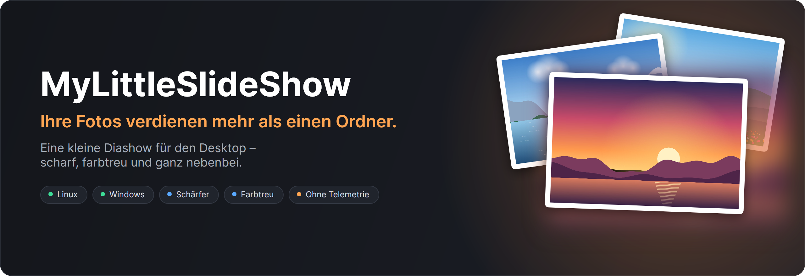
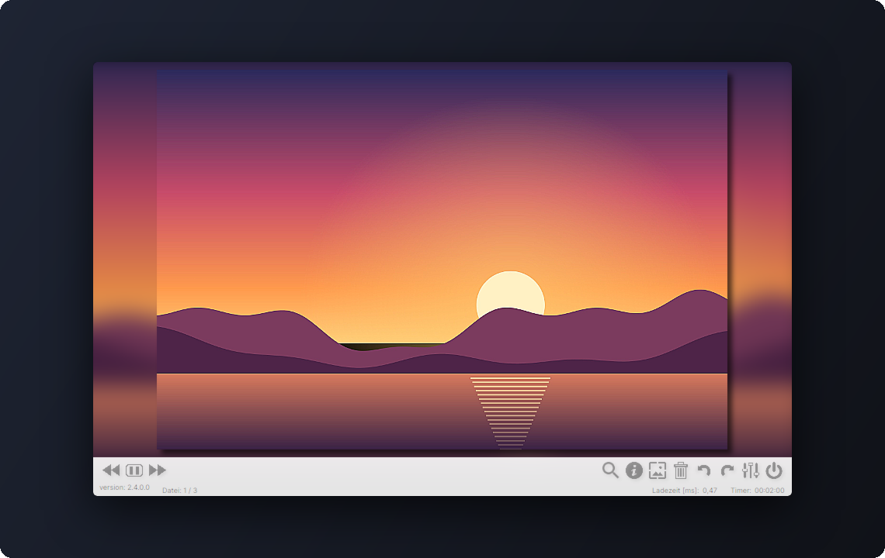
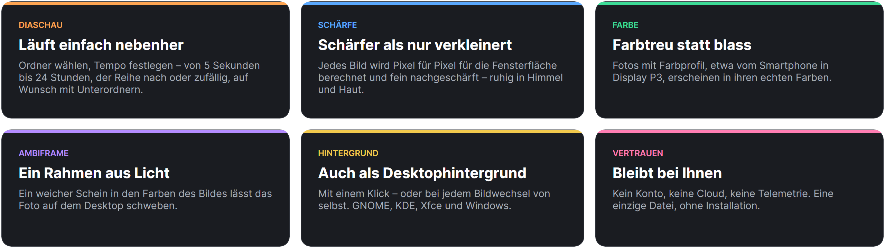
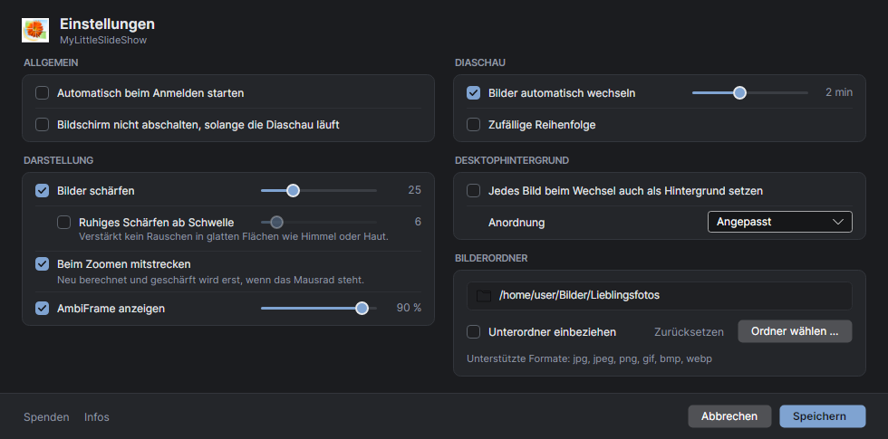

  

  
  
  
  
  

<h3 align="center">Tausende Fotos auf der Platte – und wann haben Sie sie zuletzt angesehen?</h3>

  MyLittleSlideShow holt sie zurück auf den Desktop: ein kleines Fenster, das Bild für Bild durch Ihren Ordner blättert. 
  Unaufdringlich, wunderschön scharf – und so einfach, dass man es nach einer Minute vergisst. Bis das nächste Lieblingsfoto kommt.

---

## Ein Fenster voller Erinnerungen

  

**Was Sie sehen:** das Diashow-Fenster, ganz ohne Rahmen und Titelleiste. Rechts und links schimmert der AmbiFrame – ein
weicher Schein in den Farben des Bildes. Die Bedienleiste erscheint nur, solange die Maus über dem Fenster ist: vor,
zurück, anhalten, Dateiinfos, als Hintergrund setzen, löschen, drehen, Einstellungen.

---

> **Warum es MyLittleSlideShow gibt.** Unter Windows 7 gab es sie noch: die kleinen Minianwendungen auf dem Desktop,
> darunter eine Diashow, die still in der Ecke lief. Ab und zu fiel der Blick darauf – und plötzlich war er wieder da,
> der Sommerurlaub von vor zehn Jahren, der erste Schnee im Garten, ein Lachen, das man fast vergessen hatte. Mit
> Windows 10 verschwanden die Minianwendungen, und mit ihnen diese kleinen Momente.
>
> Dabei sind es genau die Fotos, die man sonst nie wieder ansieht. Sie liegen gut sortiert in Ordnern, Jahr für Jahr,
> und warten. MyLittleSlideShow holt sie dort heraus und schenkt ihnen wieder einen Platz auf dem Desktop – heute für
> Windows und Linux, schärfer und farbtreuer als je zuvor. Schauen Sie zwischendurch einfach hin. Es lohnt sich.

---

## Höhepunkte

  

**Warum die Bilder so gut aussehen:** Ein Foto einfach auf die Fenstergröße zu schrumpfen, kostet Schärfe.
MyLittleSlideShow rechnet jedes Bild genau für die sichtbare Fläche in echten Bildschirmpixeln, auch bei
125 % oder 150 % Skalierung, und schärft es danach behutsam nach. Fotos mit Farbprofil werden richtig umgerechnet, statt
blass zu wirken.

---

## So einfach geht's

1. **Ordner wählen** – in den Einstellungen, auf Wunsch mit allen Unterordnern.
2. **Tempo festlegen** – von 5 Sekunden bis 24 Stunden, der Reihe nach oder zufällig.
3. **Zurücklehnen.** Fertig. Auf Wunsch startet die Diashow beim Anmelden von selbst.

  

Alles auf einer Seite – und mit Live-Vorschau: Wer am Regler für Schärfe oder Lichtrahmen dreht, sieht das Ergebnis sofort
im Diashow-Fenster.

### Kleine Handgriffe

| Sie tun | Es passiert |
|---|---|
| Mausrad über dem Bild | nächstes oder vorheriges Bild |
| Strg + Mausrad oder rechte Maustaste + Mausrad | Fenster größer oder kleiner |
| Doppelklick auf das Bild | das Original öffnet sich im Standard-Bildbetrachter |
| Fenster mit der Maus ziehen | an eine andere Stelle schieben |

Für Strg + Mausrad muss das Fenster einmal angeklickt sein. Das Fenster bleibt immer ganz sichtbar – auch wenn der zweite
Bildschirm abgezogen wird.

### Und alles, was man nebenbei braucht

- **Symbol in der Leiste** zum Anzeigen, Minimieren, Neustarten und Beenden.
- **Bildschirm bleibt an**, solange die Diashow läuft – auf Wunsch.
- **Drehen um 90°** direkt in der Datei; bei JPEG bleiben EXIF-Daten und Farbprofil erhalten.
- **In den Papierkorb** statt endgültig löschen.
- **Dateiinfos** zu jedem Bild: Kamera, Aufnahme, Ort, Urheber und Farbprofil aus EXIF, IPTC und XMP.
- **Formate:** JPEG, PNG, GIF, BMP und WebP.
- **Deutsch und Englisch** eingebaut, umschaltbar in den Einstellungen. Weitere Sprachen kommen als Datei in den Ordner
  `languages` neben dem Programm: *Einstellungen › Sprache › Beispieldatei erstellen* legt eine Vorlage mit allen
  Texten an – kopieren, z. B. als `fr.json`, übersetzen, fertig.

---

## Loslegen

Fertige Programme stehen unter [Releases](../../releases):

- **Linux:** `MyLittleSlideShow-<Version>-x86_64.AppImage` herunterladen, ausführbar machen (`chmod +x`) und starten.
  AppImages brauchen FUSE 2 (Debian/Ubuntu: `sudo apt install libfuse2t64`, Fedora: `sudo dnf install fuse-libs`).
- **Windows:** `MyLittleSlideShow-<Version>-win-x64.exe` starten.

Keine Installation, kein Konto: Beides ist eine einzige Datei, .NET ist schon enthalten.

<b>Selbst bauen</b>

    ./publish.sh            # fragt nach Paketform und Ziel
    ./publish.sh linux      # ohne Rückfrage, danach steht das Programm im Anwendungsmenü

Unter Windows: `.\publish.ps1`. Benötigt das .NET SDK 10; die fertigen Programme liegen danach in `published/`.
Zum Ausprobieren ohne Paket: `dotnet run --project src/MyLittleSlideShow`.

<b>Was unter Linux gebraucht wird</b>

| Funktion | Benötigt | Fällt zurück auf |
|---|---|---|
| Hintergrundbild | `gsettings` (GNOME, Cinnamon, MATE), `plasma-apply-wallpaperimage` (KDE), `xfconf-query` (Xfce) | `feh` |
| Papierkorb | `gio` (glib2) | `trash-put`, sonst eigene Umsetzung der freedesktop-Trash-Spec |
| Bildschirm an lassen | `systemd-inhibit` | `xdg-screensaver reset` |
| Datei oder Ordner öffnen | `xdg-open` (xdg-utils) | – |
| Symbol in der Leiste | StatusNotifierItem; unter GNOME die Erweiterung *AppIndicator and KStatusNotifierItem Support* | – |

Fehlt ein Werkzeug, wird nur der betroffene Knopf ausgeblendet – die Diashow startet trotzdem.

Die Einstellungen liegen unter `~/.config/MyLittleSlideShow/settings.json` (Windows: `%APPDATA%\MyLittleSlideShow\settings.json`).

---

## Lizenz

MyLittleSlideShow steht unter der [MIT-Lizenz](LICENSE): frei nutzen, weitergeben und verändern. Alle fremden Bestandteile
stehen unter freien Lizenzen – Übersicht in [THIRD-PARTY-NOTICES.md](THIRD-PARTY-NOTICES.md), im Programm unter
*Einstellungen › Infos › Lizenzen*.

Das Programm sendet nichts – keine Nutzungsdaten, keine Absturzberichte. Auch beim Bauen ist die Telemetrie von .NET,
MSBuild und Avalonia abgeschaltet.

Gefällt Ihnen MyLittleSlideShow, freut sich der Entwickler über eine Spende – der Knopf „Spenden“ unten links in den
Einstellungen.

Hinweise zum Weiterentwickeln: [ENTWICKLUNG.md](ENTWICKLUNG.md), Regeln für die Arbeit am Projekt:
[docs/ARBEITSREGELN.md](docs/ARBEITSREGELN.md).

Alle Bilder zeigen selbst gezeichnete Beispielmotive. Schrift der Grafiken: Inter (SIL Open Font License).
